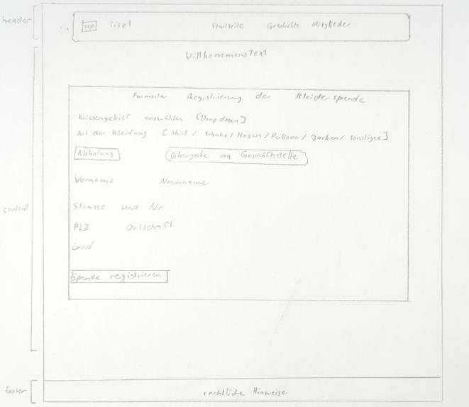
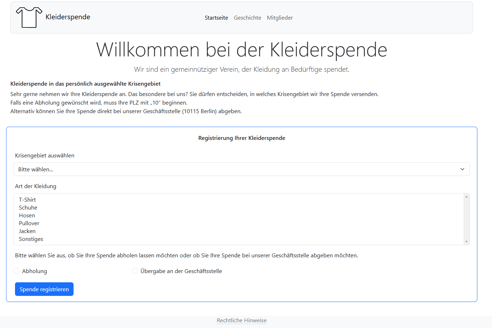
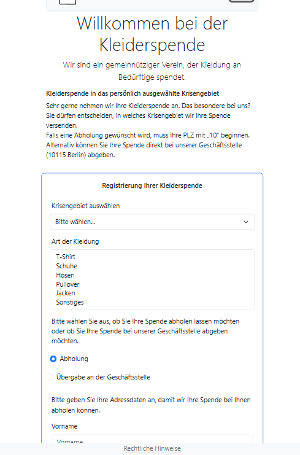

# Kleiderspende – responsive Website mit Registrierungsformular

Mehrseitige Website für einen fiktiven gemeinnützigen Verein, der Kleidung an Krisengebiete
spendet. Kernstück ist ein Formular, mit dem Spenderinnen und Spender ihre Kleiderspende
registrieren. Umgesetzt mit **HTML5, CSS (Bootstrap 5.3) und JavaScript**, ohne Build-Schritt und
ohne Backend.

Entstanden im Studium (Softwareentwicklung, Webanwendungsoberflächen) als Einzelarbeit von der
Skizze bis zur fertigen Seite.

## Vorschau

| Entwurf (Handskizze) | Desktop | Mobil |
|---|---|---|
|  |  |  |

## Funktionen

- **Registrierungsformular** mit Krisengebiet (Dropdown), Kleidungsart (Mehrfachauswahl) und
  Übergabeart (Abholung oder Abgabe an der Geschäftsstelle)
- **Dynamische Felder:** Bei Abholung erscheinen die Adressfelder und werden per JavaScript zu
  Pflichtfeldern, bei Abgabe werden sie wieder ausgeblendet
- **Validierung der Postleitzahl:** Abholung ist nur in der Nähe der Geschäftsstelle möglich, die
  PLZ muss mit „10“ beginnen. Die Meldung erscheint direkt am Feld (Browser-Validierung) und nicht
  als blockierendes Pop-up
- **Bestätigungsseite**, die die übermittelten Angaben aus der URL liest und anzeigt
- **Responsives Layout** mit Bootstrap-Grid, die Navigation klappt auf kleinen Bildschirmen zum
  Burger-Menü zusammen

## Seiten

| Seite | Inhalt |
|---|---|
| `index.html` | Vorstellung und Registrierungsformular |
| `abschluss.html` | Bestätigung mit den eingegebenen Angaben |
| `geschichte.html` | Vereinsgeschichte |
| `mitglieder.html` | Mitglieder |
| `rechtliches.html` | Rechtliche Hinweise (im Footer verlinkt) |

## Technische Umsetzung

- **HTML** und Bootstrap-Komponenten (Navigation, Formular, Karten, Footer)
- **Barrierefreiheit:** Formularfelder sind mit Labels bzw. `aria-label` verknüpft, Bilder haben
  Alternativtexte, jede Seite hat `lang="de"` und eine Meta-Beschreibung
- **Sicherer Umgang mit Eingaben:** Die Bestätigungsseite fügt die Werte aus der URL als Text ein
  (`textContent`) und nicht als HTML. Eingaben mit Skript-Code werden dadurch nur angezeigt und nicht
  ausgeführt.
- **Formularlogik in reinem JavaScript** ohne zusätzliche Bibliothek

## Ansehen

Die Datei `index.html` im Browser öffnen. Bootstrap wird per CDN geladen, dafür ist eine
Internetverbindung nötig.
